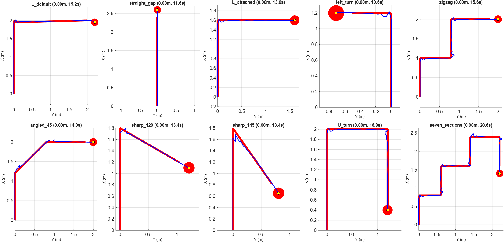
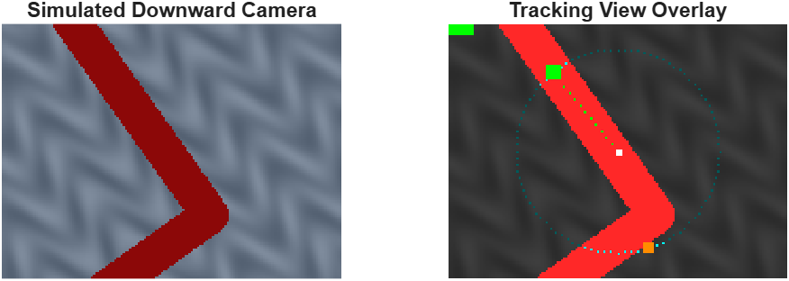

# PX4 Multicopter Perception and Control (MathWorks Minidrone Competition)

Vision-based red-line following and autonomous landing for a PX4 quadcopter in MATLAB/Simulink (`R2026b`).

## Overview

The guidance logic in [`perception/minidroneLineFollow.m`](perception/minidroneLineFollow.m) processes `120x160` RGB frames from a downward-facing camera at 5 Hz and outputs `[x; y; Z; yawCmd]` setpoints for the PX4 flight controller:

- **Red segmentation & lag compensation**: aligns each incoming frame with the vehicle pose from `cam.lagSteps` earlier (`poseHist`) so heading changes do not tilt the perceived line.
- **Ring-based line following**: samples a circular ring (`RING_PX = 48`) around the projected ground point, detects red crossings, selects the forward branch, and commands yaw + step waypoints along the line.
- **Landing circle detection**: identifies a red region wide enough to hold a `0.16 m` disk with at most one exiting line, transitions to `APPROACH`, locks onto the circle centre, and descends (`LAND`).
- **Gap & loss recovery**: bridges short gaps (`MAX_GAP = 0.8 m`) along the last travel direction and runs a local search pattern if the line is lost.

## Visual Outputs

### Multi-track offline closed-loop simulation



### Downward camera & tracking view overlay



### Offline flight demo (`seven_sections`)

- Video: [`media/offline_flight_seven_sections.mp4`](media/offline_flight_seven_sections.mp4)

## Offline Verification Results

Run `testMinidroneLineFollow` (7/7 unit checks passed) and `simulateMultiTrackOffline` (10/10 tracks passed):

| Track | Result | Land Error (m) | Max Off-Line (m) | Median Yaw Error (deg) | Yaw Reversals | Flight Time (s) |
| --- | --- | --- | --- | --- | --- | --- |
| `L_default` | PASS | 0.000 | 0.059 | 0.4 | 1 | 15.2 |
| `straight_gap` | PASS | 0.000 | 0.000 | 0.0 | 0 | 11.6 |
| `L_attached` | PASS | 0.001 | 0.040 | 0.0 | 0 | 13.0 |
| `left_turn` | PASS | 0.000 | 0.043 | 0.0 | 0 | 10.6 |
| `zigzag` | PASS | 0.000 | 0.083 | 3.5 | 2 | 15.6 |
| `angled_45` | PASS | 0.000 | 0.057 | 1.2 | 4 | 14.0 |
| `sharp_120` | PASS | 0.000 | 0.042 | 0.0 | 0 | 13.4 |
| `sharp_145` | PASS | 0.000 | 0.048 | 0.0 | 2 | 13.4 |
| `U_turn` | PASS | 0.001 | 0.048 | 0.8 | 0 | 16.8 |
| `seven_sections` | PASS | 0.000 | 0.086 | 16.7 | 7 | 20.6 |

## Repository Structure

```text
.
├── PX4MultiCopterPerceptionAndControl.prj   # MATLAB Project definition
├── OPEN_PROJECT.m                           # Opens project and top-level Simulink model
├── RUN_FLIGHT.bat                           # Launches MATLAB and starts simulation
├── initData.mat                             # Active Unreal track configuration
├── controller/
│   └── flightControlSystem.slx              # PX4 flight controller model
├── mainModels/
│   └── PX4MultiCopterPerceptionAndControl.slx
├── perception/
│   ├── minidroneLineFollow.m                # #codegen red-line follower & landing state machine
│   ├── minidroneCameraModel.m               # Downward camera intrinsics & lag parameters
│   ├── competitionTracks.m                  # 10-track library for offline checks
│   ├── renderTrackCamera.m                  # Synthetic downward camera renderer
│   ├── simulateTrackOffline.m               # Single-track closed-loop offline simulation
│   ├── simulateMultiTrackOffline.m          # Batch runner across all competition tracks
│   ├── testMinidroneLineFollow.m            # Unit tests for guidance behaviour
│   └── PerceptionAndGuidance.slx
├── perceptionAndController/
│   └── PerceptionAndControl.slx
├── scripts/
│   ├── setupParameters.m                    # PX4 QAV250 control & rate parameters
│   ├── InitVars.m                           # Project workspace initialization
│   ├── runRound1GapChecks.m                # Project registration, unit tests, offline suite, codegen
│   ├── checkPerceptionCodegen.m             # Embedded Coder / MATLAB Coder check
│   ├── runLiveFlightCheck.m                 # Top-level Unreal simulation check
│   ├── writeCompetitionTrack.m              # Writes a named track to initData.mat
│   ├── exportSubmissionArchive.m            # Packages submission archive
│   └── tests/runProjectTests.m              # MATLAB Project test runner
├── media/                                   # Rendered trajectory plots and flight demo video
└── support/                                 # MathWorks competition scene, textures, and LICENSE.md
```

## Quick Start

### Open and run in MATLAB / Simulink

1. Open MATLAB `R2026b` in the repository root and run:
   ```matlab
   OPEN_PROJECT
   ```
   Or double-click `RUN_FLIGHT.bat` on Windows to open the project and start the simulation.

### Run offline tests and codegen checks

```matlab
addpath('perception', 'scripts');
testMinidroneLineFollow();
simulateMultiTrackOffline();
```

Or run the full Round-1 readiness check (project registration, `initData.mat` generation, unit tests, multi-track offline simulation, and codegen verification):

```matlab
runRound1GapChecks();
```

To switch the active Unreal track in `initData.mat`:

```matlab
writeCompetitionTrack('zigzag');
```

## License

See [`support/LICENSE.md`](support/LICENSE.md). Portions of the base framework are copyright Fabian Riether, Sertac Karaman (MIT License) and The MathWorks, Inc.
